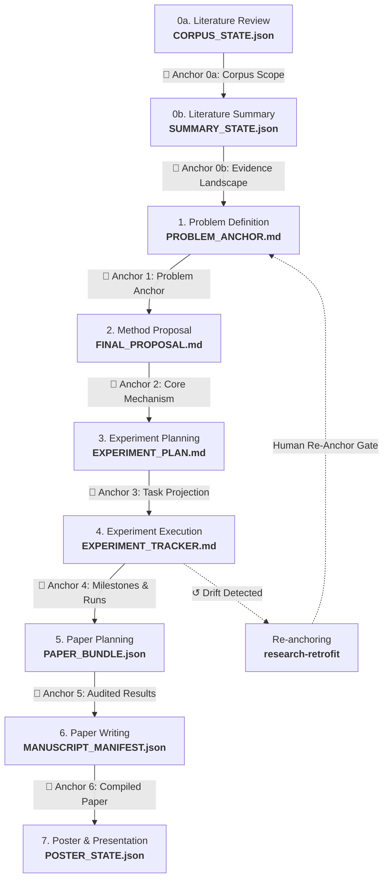

<div align="center">

# ⚓ Anchor Research

### *Anchor first. Automate second.*

**A Human-in-the-Loop Auto Research Skill Framework**

[](LICENSE)
[](#-what-is-an-anchor)
[](#-skills-index)
[](#-usage--runtime-compatibility)

<br>

<p align="center">
  <a href="#readme"><b>English</b></a> •
  <a href="README.zh.md"><b>简体中文</b></a>
</p>

<br>


<br>

[🎯 Motivation](#-why-anchor-research) •
[⚓ What is an Anchor](#-what-is-an-anchor) •
[🏛️ Architecture](#-system-architecture) •
[📦 Skills Index](#-skills-index) •
[🚀 Workflow](#-typical-workflow-the-happy-path) •
[📄 Artifacts](#-concrete-artifact-hierarchy) •
[🤝 Handoff Protocol](#-stage-handoff-protocol)

</div>

---

## 🎯 Why Anchor Research?

Traditional automated research (Auto Research) operates under the fallacy of **"automate first, think later"**:
1. You give a general direction or broad question to an autonomous agent.
2. The agent runs in an unguided feedback loop: autonomously generating code, executing training runs, selecting baselines, and rewriting proposals.
3. **Nobody notices when the scientific objective silently drifts.**

By the time the paper draft is generated, it often solves an easier, uninteresting toy problem rather than your original bottleneck. **Dozens of GPU-weeks and months of research time are squandered on an ungrounded hallucination.**

> [!IMPORTANT]
> **Anchor Research reverses this model: Drop an immutable anchor at every stage before automating.**
> An **Anchor** is not just an initial prompt; it is a **continuous chain of cryptographic human checkpoints** across the entire research lifecycle. No downstream code execution, experiment deployment, or manuscript drafting is permitted until the previous stage's decisions are **inspected, discussed, and explicitly approved by the researcher**.

### ⚖️ Auto Research vs. Anchor Research

| Feature | ❌ Traditional Auto Research | ⚓ Anchor Research |
|---|---|---|
| **Human Role** | Spectator at the end (or debugger when it crashes) | **Pilot at every decision gate (Human-in-the-Loop)** |
| **Stage Progression** | Autonomous cascading without human alignment | **Explicit single-stage handoff with cryptographic hash binding** |
| **Goal Drift Handling** | Silent topic substitution to achieve higher scores | **Drift warnings halt new work; mandatory human re-anchoring** |
| **Code vs. Problem** | Code changes silently rewrite the research problem | **Code is implementation truth, NOT authority over user problem** |
| **Metric Verification** | Self-reported agent numbers or synthetic mocks | **Audited normalization vs. raw predictions & ground-truth labels** |
| **Execution Permission** | Automatic background scripts & process control | **Separated permissions: Entry ≠ Approval ≠ Consequential Action** |

---

## ⚓ What Is an "Anchor"?

An anchor is **a concrete decision that has been presented to the researcher, discussed, explicitly confirmed, and committed as an immutable state at a stage boundary**.

It possesses three non-negotiable properties:

1. 🔒 **Explicitly Confirmed (Confirm-then-Commit)**:
   It is never an optimistic progress flag or an automated agent guess. An anchor exists only when an actual human affirmatively approves the exact presented content. **An LLM review score, a passing test script, silence, or a timeout can never substitute for human confirmation.**
2. 🔍 **Verifiable & Cryptographically Bound**:
   Every subsequent stage verifies the upstream anchors through exact file-byte SHA-256 hashes and canonical JSON digests (`anchor check`), immediately detecting any unauthorized tampering or accidental drift.
3. 👑 **Authoritative Over Automation**:
   Anchors outrank autonomous agent heuristics. When automated experiments conflict with an anchor, execution must **pause and consult the researcher** rather than quietly shifting direction.

---

## 🔗 The 8-Stage Anchor Chain



| # | Stage | Anchor Artifact | What Gets Confirmed with You | Responsible Skill |
|---|---|---|---|---|
| **0a** | Literature Review | `CORPUS_STATE.json` | Corpus query coverage, deduplicated paper inventory, enabled sources, and evidence boundaries | [`research-literature-review`](skills/research-literature-review/SKILL.md) |
| **0b** | Literature Summary | `SUMMARY_STATE.json` | Cross-paper synthesis, open research gaps, method lineages, and abstraction limits | [`research-literature-summary`](skills/research-literature-summary/SKILL.md) |
| **1** | Problem Framing | `PROBLEM_ANCHOR.md` | In literature-driven mode, 4–6 candidates are ranked; you pick the route, then explicitly approve the drafted problem bottleneck and non-goals | [`research-ideas`](skills/research-ideas/SKILL.md) |
| **2** | Method Proposal | `FINAL_PROPOSAL.md` | Single dominant mechanism delta, parsimonious formulation, and minimal claim-validation sketch after independent review | [`research-ideas`](skills/research-ideas/SKILL.md) |
| **3** | Experiment Planning | `EXPERIMENT_PLAN.md`<br>+ `EXPERIMENT_PLAN_STATE.json` | Falsifiable claims, milestone stop/go gates, compute budget ceiling, and approved task projection | [`research-experiment-plannning`](skills/research-experiment-plannning/SKILL.md) |
| **4** | Experiment Execution | `EXPERIMENT_TRACKER.md` | Single tracker lifecycle; deployment checks approved task projection; failures or milestone gates pause for your strategy decisions | [`research-run-experiment`](skills/research-run-experiment/SKILL.md) |
| **5** | Paper Planning | `PAPER_PLAN.md`<br>+ `PAPER_BUNDLE.json` | Audited metric normalization vs. saved ground truth; runnable plotting code; tables & plots; paper storyline User Confirmation Loop | [`research-paper-plan`](skills/research-paper-plan/SKILL.md) |
| **6** | Paper Writing | `main.pdf` + `main.tex`<br>+ `MANUSCRIPT_MANIFEST.json` | Full section composition using conference templates; verified citations; 100% number-to-result traceability ledger; human approval of final manuscript | [`research-paper-writing`](skills/research-paper-writing/SKILL.md) |
| **7** | Presentation Delivery | `main.pdf` + `poster.pptx`<br>+ `poster.svg` + `POSTER_SPEECH.md` | 60-second visual storyline; content plan and card layout checkpoints require explicit human approval; multi-format verified exports | [`research-paper-poster`](skills/research-paper-poster/SKILL.md) |

> [!NOTE]
> **Re-Anchoring vs. Problem Drift (`research-retrofit`)**:
> When implementation code diverges from the written proposal, `research-retrofit` reverse-engineers the codebase. **Code is ground truth for what was implemented, NOT authority over the researcher's goal.** If problem drift is identified, the skill pauses and asks you: *Should we adjust the implementation to match the original anchor, or do you explicitly confirm re-anchoring the problem?*

---

## 🏛️ System Architecture

Anchor Research is organized into 5 cooperative functional tiers, governed by the central protocol skill [`research-shared-references`](skills/research-shared-references/SKILL.md):

```text
 ┌─ 1. Knowledge & Literature Layer ───────────────────────────────────────────────┐
 │  wiki-pk-base (Persistent PKBase Vault)  ◄──►  research-daily-ideas (Daily Feed)│
 │        │                                                                        │
 │        ▼                                                                        │
 │  research-literature-review  ──► 📌 Anchor 0a: Corpus Scope Approval            │
 │        │                                                                        │
 │        ▼                                                                        │
 │  research-literature-summary ──► 📌 Anchor 0b: Evidence Landscape Approval      │
 └──────────────────────────────────────────┬──────────────────────────────────────┘
                                            ▼
 ┌─ 2. Research Proposal Layer ────────────────────────────────────────────────────┐
 │  research-ideas:                                                                │
 │    Candidate Selection (4–6 choices) ──► 📌 Anchor 1: PROBLEM_ANCHOR.md         │
 │    Method Synthesis ──► Multi-round Review ──► 📌 Anchor 2: FINAL_PROPOSAL.md   │
 └──────────────────────────────────────────┬──────────────────────────────────────┘
                                            ▼
 ┌─ 3. Experimentation Layer ──────────────────────────────────────────────────────┐
 │  research-experiment-plannning:                                                 │
 │    Roadmap & Milestones ──► 📌 Anchor 3: Approved Task Projection               │
 │        │                                                                        │
 │        ▼                                                                        │
 │  research-run-experiment:                                                       │
 │    Reconcile tracker ──► Deploy authorized runs ──► Evaluate vs. Ground Truth   │
 │    [Helper] research-structured-codebase (Registry-driven PyTorch framework)    │
 │    [Helper] research-training-check (Read-only training quality diagnostics)    │
 │    📌 Anchor 4: Milestone Human Decision Gates & Failure Pauses                 │
 └──────────────────────────────────────────┬──────────────────────────────────────┘
                                            ▼
 ┌─ 4. Paper & Delivery Layer ─────────────────────────────────────────────────────┐
 │  research-paper-plan:                                                           │
 │    Audit metrics vs predictions ──► Execute plotting scripts ──► Build tables   │
 │    📌 Anchor 5: PAPER_BUNDLE.json & Narrative Storyline (Human Confirmation)    │
 │        │                                                                        │
 │        ▼                                                                        │
 │  research-paper-writing:                                                        │
 │    Draft sections ──► Programmatic citation verification ──► Real LaTeX compile │
 │    📌 Anchor 6: MANUSCRIPT_MANIFEST.json & Final Manuscript (Human Approval)    │
 │        │                                                                        │
 │        ▼                                                                        │
 │  research-paper-poster:                                                         │
 │    📌 Anchor 7: Poster Content Plan & Card Grid Checkpoints (Human Approval)    │
 │    A0/A1 Print PDF + Native & Component PPTX + SVG + Presentation Script        │
 └─────────────────────────────────────────────────────────────────────────────────┘

 ↺ research-retrofit: Bridges code back to proposal. Reverse-engineers code,
   detects implementation gaps, and initiates a formal human re-anchoring gate.
```

---

## 📦 Skills Index

The repository provides **14 host-neutral skills** under `skills/`:

### 📚 Literature & Knowledge

* **[`research-literature-review`](skills/research-literature-review/SKILL.md)** (`v2.7.0`): Multi-source paper search across Zotero, PKBase, Obsidian notes, and arXiv. Normalizes into unified `research_foundation_review.json`. Requires `corpus_approval`.
* **[`research-literature-summary`](skills/research-literature-summary/SKILL.md)` (`v1.8.0`): Deep paper comprehension using one isolated subagent per paper, followed by global landscape synthesis (`overview_summary.md`, `aggregate_report.md`). Requires `summary_approval`.
* **[`wiki-pk-base`](skills/wiki-pk-base/SKILL.md)** (`v1.4.0`): Persistent Personal Knowledge Base (PKBase) following Karpathy's LLM Wiki pattern. Interlinked Markdown vault with a live browser site showcase.
* **[`research-daily-ideas`](skills/research-daily-ideas/SKILL.md)** (`v1.1.0`): Daily arXiv preprint harvester matching research topics or Zotero profiles. Downloads TeX/figures, writes analyses, and files to PKBase.

### 🧠 Proposal & Methodology

* **[`research-ideas`](skills/research-ideas/SKILL.md)** (`v6.0.0`): Proposal design grounded in literature evidence. Offers 4–6 distinct candidates for human selection; locks `PROBLEM_ANCHOR.md`; conducts adversarial subagent reviews; commits `FINAL_PROPOSAL.md` upon explicit user approval.
* **[`research-retrofit`](skills/research-retrofit/SKILL.md)** (`v2.0.0`): Reverse-engineers implemented code against research reports. Formulates gap analyses (`CODE_ANALYSIS.md`) and conducts human re-anchoring gates before updating canonical files.

### 🧪 Experimentation & Execution

* **[`research-experiment-plannning`](skills/research-experiment-plannning/SKILL.md)** (`v3.0.0`): Claim-driven validation roadmap (`EXPERIMENT_PLAN.md`) with milestone stop/go gates and compute budgets. Generates `approved_task_inventory` projection and initializes single tracker `EXPERIMENT_TRACKER.md`. Requires human `plan_approval`.
* **[`research-run-experiment`](skills/research-run-experiment/SKILL.md)** (`v4.4.0`): Single tracker lifecycle manager. Reconciles runs against the approved task projection, deploys authorized jobs, monitors training, evaluates predictions against dataset labels, and pauses for human decision on milestone gates or drift.
* **[`research-structured-codebase`](skills/research-structured-codebase/SKILL.md)** (`v2.0.0`): Modular, registry-driven PyTorch framework template (inspired by Dassl/Detectron2). Optional implementation assistant for `research-run-experiment`.
* **[`research-training-check`](skills/research-training-check/SKILL.md)** (`v2.0.0`): Quality diagnostic helper. Reads real-time training metrics/logs, diagnoses learning health (NaNs, divergence, plateaus), and outputs immutable advisory reports to `docs/research-training-check/`. Never terminates processes or alters the tracker.

### ✍️ Paper & Presentation

* **[`research-paper-plan`](skills/research-paper-plan/SKILL.md)** (`v3.1.0`): Empirical data audit and narrative planning. Recomputes metrics from stored predictions and ground truth; runs plotting code in `docs/research-paper-plan/analysis/`; builds publication tables and vector plots; establishes code-to-claim tracing; requires human confirmation on `PAPER_BUNDLE.json`.
* **[`research-paper-writing`](skills/research-paper-writing/SKILL.md)** (`v3.1.0`): Detailed manuscript composition using official conference templates (ICLR, NeurIPS, ICML, ACL, AAAI). Features programmatic citation verification, 100% numerical traceability ledger, real LaTeX compilation, independent review, and human manuscript approval.
* **[`research-paper-poster`](skills/research-paper-poster/SKILL.md)** (`v3.1.0`): Conference presentation generator. Distills a 60-second visual story from the final paper and data. Renders A0/A1 posters, checks card layout, conducts visual inspection, and exports editable/component PPTX, SVG, and talk script (`POSTER_SPEECH.md`).

### 🛡️ Protocols & Standards

* **[`research-shared-references`](skills/research-shared-references/SKILL.md)** (`v1.0.0`): System-wide specifications governing human anchor gates ([`anchor-gates.md`](skills/research-shared-references/anchor-gates.md)), stage handoffs, cryptographic digests, and anti-drift contracts.

---

## 🚀 Typical Workflow: The Happy Path

```text
1.  /research-literature-review  ──► Search Zotero & Web into research_foundation_review.json
        📌 Human Anchor: Confirm corpus scope, enabled sources, and paper inventory
2.  /research-literature-summary ──► Run per-paper analyzers & synthesize landscape report
        📌 Human Anchor: Confirm synthesized evidence landscape and identified gaps
3.  /research-ideas              ──► Generate 4–6 candidate directions from evidence gaps
        📌 Human Anchor: Choose your preferred candidate route
        📌 Human Anchor: Approve drafted Problem Anchor (bottleneck + non-goals)
        ├── Multi-round independent host-subagent review & iterative refinement
        📌 Human Anchor: Approve finalized method proposal (FINAL_PROPOSAL.md)
4.  /research-experiment-plannning ──► Translate claims into milestone blocks & task roadmap
        📌 Human Anchor: Approve experiment plan, decision gates, and compute budget cap
5.  /research-run-experiment     ──► Deploy authorized runs, evaluate predictions vs. ground truth
        ├── (Optional) /research-structured-codebase for modular architecture
        ├── (Optional) /research-training-check for metric health diagnostics
        📌 Human Anchor: Milestone decision gates & failure recovery require human decision
6.  [If implementation drifts] /research-retrofit ──► Code analysis & gap diagnostics
        📌 Human Anchor: Decide whether to adjust implementation or re-anchor the problem
7.  /research-paper-plan         ──► Audit raw metrics, execute plotting scripts, plan story
        ├── Generates runnable analysis, publication CSV/LaTeX tables, vector plots
        ├── Independent review of claim-evidence matrix & code trace
        📌 Human Anchor: User Confirmation Loop approving the exact PAPER_BUNDLE.json
8.  /research-paper-writing      ──► Draft complete manuscript with official conference template
        ├── Verified BibTeX citations & numeric assertion traceability ledger
        ├── Real LaTeX compiler execution & independent AC review
        📌 Human Anchor: Approve final compiled manuscript & MANUSCRIPT_MANIFEST.json
9.  /research-paper-poster       ──► Generate A0/A1 poster, PPTX/SVG exports & talk script
        📌 Human Anchor: Confirm poster content plan and visual card layout
```

---

## 📄 Concrete Artifact Hierarchy

All project state lives within standard directories under `docs/`. State files are concrete, verifiable anchors:

| File Path | Nature of the Anchor | Author Skill | Primary Consumers |
|---|---|---|---|
| `docs/research-literature-review/CORPUS_STATE.json` | Corpus Scope Anchor | `research-literature-review` | `research-literature-summary` |
| `docs/research-literature-summary/SUMMARY_STATE.json` | Evidence Landscape Anchor | `research-literature-summary` | `research-ideas` |
| `docs/research-ideas/PROBLEM_ANCHOR.md` | Immutable Problem Anchor (Bottleneck & Non-Goals) | `research-ideas` / `research-retrofit` | All downstream skills (Anti-Drift Baseline) |
| `docs/research-ideas/FINAL_PROPOSAL.md` | Method Proposal Anchor (Dominant Delta & Minimal Test) | `research-ideas` / `research-retrofit` | Planning, runner, paper-plan |
| `docs/research-experiment-plannning/EXPERIMENT_PLAN.md` | Strategy Anchor (Claims, Criteria & Milestones) | `research-experiment-plannning` | Runner, retrofit, paper-plan |
| `docs/research-experiment-plannning/EXPERIMENT_TRACKER.md` | Execution Record Anchor (Single Tracker, Metrics & Logs) | `research-experiment-plannning` / `research-run-experiment` | Researcher + downstream |
| `docs/research-paper-plan/PAPER_PLAN.md` + `PAPER_BUNDLE.json` | Narrative & Evidence Anchor (Audited Data, Plots & Story) | `research-paper-plan` | `research-paper-writing` |
| `docs/research-paper-writing/MANUSCRIPT_MANIFEST.json` | Manuscript Anchor (PDF, TeX Includes, Build Log, Reviews) | `research-paper-writing` | `research-paper-poster` |
| `docs/research-paper-poster/POSTER_STATE.json` | Delivery Anchor (Poster PDF, PPTX, SVG, Speech Script) | `research-paper-poster` | Researcher (Presentation) |

---

## 🤝 Stage Handoff Protocol

Stage transitions between adjacent skills follow the **Explicit Handoff Protocol** defined in [`research-shared-references/anchor-gates.md`](skills/research-shared-references/anchor-gates.md) (or trigger [`research-shared-references`](skills/research-shared-references/SKILL.md)):

```json
{
  "from_skill": "research-ideas",
  "to_skill": "research-experiment-plannning",
  "project_root": "/absolute/path/to/project",
  "docs_root": "/absolute/path/to/project/docs",
  "invocation": "/research-experiment-plannning \"/absolute/path/to/project/docs/research-ideas/FINAL_PROPOSAL.md\" project: \"/absolute/path/to/project\"",
  "proposal_path": "/absolute/path/to/project/docs/research-ideas/FINAL_PROPOSAL.md",
  "proposal_sha256": "3a8b...4f",
  "anchor_path": "/absolute/path/to/project/docs/research-ideas/PROBLEM_ANCHOR.md",
  "anchor_sha256": "9c1e...2d",
  "method_state_path": "/absolute/path/to/project/docs/research-ideas/REVIEW_STATE.json",
  "method_state_sha256": "e4f0...7a",
  "artifacts": [
    {"role": "proposal", "path": ".../FINAL_PROPOSAL.md", "sha256": "3a8b...4f"},
    {"role": "anchor", "path": ".../PROBLEM_ANCHOR.md", "sha256": "9c1e...2d"},
    {"role": "method-state", "path": ".../REVIEW_STATE.json", "sha256": "e4f0...7a"}
  ],
  "status": "awaiting_confirmation"
}
```

### The 5 Iron Rules of Handoffs:
1. **One Offer at a Time**: When a stage finishes and its human anchor is approved, it posts a single conversation-scoped `NEXT_SKILL_HANDOFF` JSON object with `status: "awaiting_confirmation"`.
2. **Cryptographic Hash Binding**: Handoffs enumerate all consumed inputs with absolute paths, exact SHA-256 byte hashes, and canonical JSON digests.
3. **Permission Does Not Cascade**: Replying "yes" or "continue" authorizes **only the offered stage once**. It never authorizes subsequent stages, unapproved training runs, or paper publication.
4. **Stale on Input Modification**: If any bound input file changes before the receiver acts, the offer immediately stales and requires re-presentation.
5. **No Timeout Auto-Approval**: Silence, timeout, or autonomous flags **never grant permission to cross an anchor gate**.

---

## 🛠️ Usage & Runtime Compatibility

Anchor Research skills are designed to be **host-neutral** and run seamlessly with any AI agent environment that supports tools/skills:

### Claude Code / Anthropic Agent
Link or copy the `skills/` directory into your project's `.claude/skills/` or global skills directory:
```bash
ln -s /path/to/anchor-research/skills ~/.claude/skills/anchor-research
```

### VS Code Copilot / Generic Agent
Point your agent workspace settings to the `skills/` directory or load specific `SKILL.md` files as system prompts.

### Triggers & Usage Examples:
- **Refine an Idea**: `refine my approach: <problem description>`
- **Literature Review**: `literature review topic: "Flow Matching for 3D Animation"`
- **Plan Experiments**: `experiment plan: design ablation matrix for our method`
- **Run Experiments**: `run experiment` (automatically identifies next approved `TODO` run)
- **Check Training**: `check training run: <run_id> metrics: loss, eval_acc`
- **Plan Paper**: `paper plan: audit experiment results and outline the paper`
- **Draft Paper**: `write paper: compile ICLR 2026 conference paper`
- **Make Poster**: `make poster: create A0 conference poster and talk script`

---

## 📜 Repository Structure

```text
anchor-research/
├── README.md                          # Master English documentation
├── README.zh.md                       # Master Chinese documentation
├── assets/
│   └── anchor-research-banner.svg     # Architecture flow diagram
└── skills/
    ├── research-shared-references/    # Canonical human anchor gate & protocol specification
    │   ├── SKILL.md                   # Skill definition & protocol index
    │   └── anchor-gates.md            # Detailed anchor gate specification
    ├── research-literature-review/    # Corpus collection, deduplication & normalization
    ├── research-literature-summary/   # Per-paper analyses & landscape synthesis
    ├── wiki-pk-base/                  # Persistent LLM Wiki knowledge base (PKBase)
    ├── research-daily-ideas/          # Daily arXiv discovery & PKBase feeder
    ├── research-ideas/                # Problem anchor & iterative proposal refinement
    ├── research-retrofit/             # Code-driven proposal overhaul & human re-anchoring
    ├── research-experiment-plannning/ # Claim mapping, milestone gates & tracker initialization
    ├── research-run-experiment/       # Authorized deployment, monitoring & evaluation
    ├── research-structured-codebase/  # Modular registry-driven training framework
    ├── research-training-check/       # Diagnostic quality monitoring (read-only advice)
    ├── research-paper-plan/           # Results audit, plots/tables & narrative bundle
    ├── research-paper-writing/        # Template-based drafting, compilation & verification
    └── research-paper-poster/         # Conference poster, multi-format export & talk script
```

---

## 📄 License

MIT License. Author: Zhihao Li.
