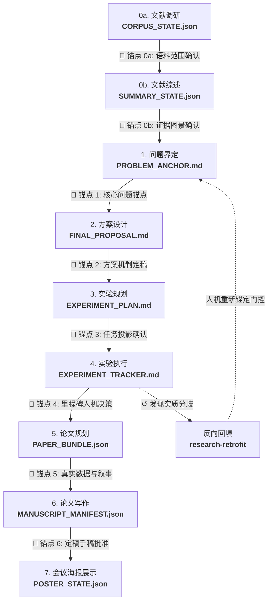

<div align="center">


<h3><i>Anchor first. Automate second.（先下锚，再自动化）</i></h3>

<p><b>基于人机对齐锚点门控的自动化科研（Auto Research）Skill 框架系统</b></p>

[](LICENSE)
[](#-什么是锚点anchor)
[](#-skills-一览)
[](#-使用方式与环境兼容)

<p align="center">
  <a href="README.md"><b>English</b></a> •
  <a href="#readme"><b>简体中文</b></a>
</p>

[🎯 核心动机](#-核心动机为什么需要-anchor-research) •
[⚓ 什么是锚点](#-什么是锚点anchor) •
[🏛️ 框架架构](#-系统架构与数据流) •
[📦 Skills 索引](#-skills-一览) •
[🚀 工作流程](#-典型工作流程happy-path) •
[📄 产物层级](#-实体产物与状态文件权威层级) •
[🤝 衔接协议](#-阶段衔接门控协议stage-handoff-protocol)

</div>

---

## 🎯 核心动机：为什么需要 Anchor Research？

传统的自动化科研（Auto Research）存在着严重的**“先自动化，再说”**认知陷阱：
1. 给 Agent 一个宽泛的探索方向或初步想法；
2. Agent 随即陷入无约束的死循环：自动写代码、自动跑训练、自动堆叠 Baseline、自动改写 Proposal；
3. **科研方向在此过程中发生静默漂移，却无人察觉。**

等最终论文草稿生成出来，研究者往往哭笑不得地发现：Agent 绕开硬骨头，解决了一个无关紧要的平庸问题。**数十个 GPU 周的算力与数月的心血，就这样白白消耗在失控的幻觉中。**

> [!IMPORTANT]
> **Anchor Research 反其道而行之：在自动化每一步展开前，先落下不可篡改的人机对齐锚点。**
> “锚点（Anchor）”绝不仅是一开始的那篇 Prompt，而是**贯穿全科研生命周期的一系列确定性人机对齐门控**。文献范围、演化图景、问题瓶颈、方法机制、实验指标、每轮里程碑、论文大纲、定稿手稿，都必须**先向研究者呈现、充分沟通确认、固化为不可变文件**，后续阶段的自动化操作才被允许启动。

### ⚖️ 传统 Auto Research 与 Anchor Research 对比

| 核心特性 | ❌ 传统 Auto Research | ⚓ Anchor Research |
|---|---|---|
| **研究者的角色** | 终局时才看的看客（或报错时的修 bug 工） | **每个决策节点不可替代的领航员（Human-in-the-Loop）** |
| **阶段推进方式** | 无人监管的自主级联执行 | **单阶段显式 Handoff，严格基于文件 SHA-256 密码学摘要绑定** |
| **目标漂移处理** | 悄悄偷换容易做的课题以刷高“成功率” | **漂移即刻触发警报并暂停后续工作，提请研究者显式重新锚定** |
| **代码与问题关系** | 随意修改方案去迎合写出来的代码 | **代码是实现真相，绝无凌驾于研究者原始问题的权威** |
| **实验指标核验** | 依赖 Agent 自报数字或虚假 Mock | **基于已保存预测值与真实标签的归一化审计与可运行脚本绘图** |
| **操作权限管控** | 默认赋予后台脚本自动执行/杀进程权限 | **三权严格分离：阶段准入 ≠ 产物批准 ≠ 实质外部动作授权** |

---

## ⚓ 什么是“锚点（Anchor）”？

锚点是**在某个科研阶段结束前，向研究者完整呈现、经过充分讨论确认，并固化为物理文件的核心结论**。

它具备三个不可逾越的基本属性：

1. 🔒 **显式确认（Confirm-then-Commit）**：
   绝非 Agent 单方面的乐观草稿，也不是代码库测试通过的零返回值。只有人类研究者明确签署批准，锚点才告成立。**大模型审稿自评高分、静默或等待超时，永远无法替代人类确认。**
2. 🔍 **密码学级可校验（Verifiable）**：
   下游所有阶段必须通过精确的文件字节 SHA-256 和规范 JSON 摘要回读上游锚点（`anchor check`），任何文件篡改或数据漂移都会导致执行即刻中断。
3. 👑 **绝对权威性（Authoritative Over Automation）**：
   锚点的权威性绝对高于 Agent 的启发式自主探索。一旦实验结果或代码与锚点冲突，系统必须**停下来向研究者请示决策**，严禁擅自偏航。

---

## 🔗 全流程 8 重人机锚点链



| # | 阶段 | 锚点实体文件 | 与研究者确认的核心内容 | 负责 Skill |
|---|---|---|---|---|
| **0a** | 文献检索 | `CORPUS_STATE.json` | 检索覆盖度、去重文献清单、启用数据源与证据边界限制 | [`research-literature-review`](skills/research-literature-review/SKILL.md) |
| **0b** | 深度综述 | `SUMMARY_STATE.json` | 跨论文综合图景、技术谱系演化、已有工作局限与开放缺陷 | [`research-literature-summary`](skills/research-literature-summary/SKILL.md) |
| **1** | 问题界定 | `PROBLEM_ANCHOR.md` | 文献驱动时呈现 4–6 个候选供显式挑选；锁定不可变的核心瓶颈、应用场景与明确非目标 | [`research-ideas`](skills/research-ideas/SKILL.md) |
| **2** | 方案设计 | `FINAL_PROPOSAL.md` | 单一主导机制增量、极简公式接口与最小验证闭环，经独立审稿后定稿方案 | [`research-ideas`](skills/research-ideas/SKILL.md) |
| **3** | 实验规划 | `EXPERIMENT_PLAN.md`<br>+ `EXPERIMENT_PLAN_STATE.json` | 核心 claims、里程碑决策门控（Stop/Go）、算力预算上限及核准任务投影 | [`research-experiment-plannning`](skills/research-experiment-plannning/SKILL.md) |
| **4** | 实验执行 | `EXPERIMENT_TRACKER.md` | 单一追踪器生命周期；部署前核验计划投影；遇到失败或里程碑门控时暂停等待人类决策 | [`research-run-experiment`](skills/research-run-experiment/SKILL.md) |
| **5** | 论文规划 | `PAPER_PLAN.md`<br>+ `PAPER_BUNDLE.json` | 对照预测值与标签审计指标；运行制图脚本生成真实矢量图表；确认论文故事线 | [`research-paper-plan`](skills/research-paper-plan/SKILL.md) |
| **6** | 论文写作 | `main.pdf` + `main.tex`<br>+ `MANUSCRIPT_MANIFEST.json` | 会议模板排版；程序化检验 BibTeX 引用；100% 数值可追溯账本；批准定稿手稿清单 | [`research-paper-writing`](skills/research-paper-writing/SKILL.md) |
| **7** | 展示交付 | `main.pdf` + `poster.pptx`<br>+ `poster.svg` + `POSTER_SPEECH.md` | 提炼 60 秒视觉叙事；内容大纲与卡片布局 checkpoints 默认等待用户确认；多格式检验导出 | [`research-paper-poster`](skills/research-paper-poster/SKILL.md) |

> [!NOTE]
> **重新锚定 vs. 目标漂移（`research-retrofit`）**：
> 当实验实现与原初方案产生分歧时，`research-retrofit` 对代码进行逆向工程分析。**代码是代码实现的真相，但绝非研究者科研目标的权威。** 系统会诊断分歧并向您提问：*是修改代码实现以符合原问题，还是由您明确确认重新下锚（Re-anchor）以适应当前实现？* 严防 Agent 擅自改写问题定义。

---

## 🏛️ 系统架构与数据流

Anchor Research 将整个科研链路划分为 5 大协同层级，统一由顶层协议技能 [`research-shared-references`](skills/research-shared-references/SKILL.md) 约束管理：

```text
 ┌─ 1. 知识与文献层 ───────────────────────────────────────────────────────────────┐
 │  wiki-pk-base（持久化 PKBase 知识库） ◄──► research-daily-ideas（每日预印本流入） │
 │        │                                                                        │
 │        ▼                                                                        │
 │  research-literature-review  ──► 📌 锚点 0a: 语料覆盖范围确认                  │
 │        │                                                                        │
 │        ▼                                                                        │
 │  research-literature-summary ──► 📌 锚点 0b: 演化图景与缺陷确认                 │
 └──────────────────────────────────────────┬──────────────────────────────────────┘
                                            ▼
 ┌─ 2. 方案层（Proposal Layer）───────────────────────────────────────────────────┐
 │  research-ideas:                                                                │
 │    候选路线挑选 (4–6 个选项) ──► 📌 锚点 1: PROBLEM_ANCHOR.md (确认问题)       │
 │    机制深度设计 ──► 独立同行评审 ──► 📌 锚点 2: FINAL_PROPOSAL.md (确认方案)    │
 └──────────────────────────────────────────┬──────────────────────────────────────┘
                                            ▼
 ┌─ 3. 实验层（Experimentation Layer）─────────────────────────────────────────────┐
 │  research-experiment-plannning:                                                 │
 │    路线与里程碑规划 ──► 📌 锚点 3: 核准任务清单投影 (approved_task_inventory)    │
 │        │                                                                        │
 │        ▼                                                                        │
 │  research-run-experiment:                                                       │
 │    追踪器对齐 ──► 部署授权运行 ──► 严格比对数据集真实标签评估                   │
 │    [辅助] research-structured-codebase（模块化注册表驱动训练框架）              │
 │    [辅助] research-training-check（无副作用指标质量诊断报告）                   │
 │    📌 锚点 4: 里程碑人机决策门控与遇阻策略确认                                  │
 └──────────────────────────────────────────┬──────────────────────────────────────┘
                                            ▼
 ┌─ 4. 论文与展示层（Paper & Delivery Layer）──────────────────────────────────────┐
 │  research-paper-plan:                                                           │
 │    真实指标归一化审计 ──► 运行分析制图脚本 ──► 输出真实图表与表格               │
 │    📌 锚点 5: PAPER_BUNDLE.json 与论文叙事线 (用户审核确认循环)                 │
 │        │                                                                        │
 │        ▼                                                                        │
 │  research-paper-writing:                                                        │
 │    细化章节起草 ──► 引文程序化验证 ──► 真实编译器编译 ──► 独立同行审稿          │
 │    📌 锚点 6: MANUSCRIPT_MANIFEST.json 与定稿论文 (确认定稿手稿)                │
 │        │                                                                        │
 │        ▼                                                                        │
 │  research-paper-poster:                                                         │
 │    📌 锚点 7: 海报大纲与视觉卡片布局 (人机逐 Checkpoint 确认)                   │
 │    A0/A1 打印级 PDF + 原生与分卡片 PPTX + 矢量 SVG + 展台演讲脚本               │
 └─────────────────────────────────────────────────────────────────────────────────┘

 ↺ research-retrofit: 代码反哺方案。逆向解析代码实现，诊断功能缺口，
   提请研究者明确决策是否重新下锚，经批准后方更新正式文档。
```

---

## 📦 Skills 一览

本仓库在 `skills/` 下提供了 **14 个宿主中立的专业技能**：

### 📚 文献与知识层

* **[`research-literature-review`](skills/research-literature-review/SKILL.md)** (`v2.7.0`)：多源文献采集（Zotero、PKBase、Obsidian、arXiv），去重与规范化输出 `research_foundation_review.json`。在 `CORPUS_STATE.json` 中需要人类确认 `corpus_approval`。
* **[`research-literature-summary`](skills/research-literature-summary/SKILL.md)** (`v1.8.0`)：文献深度综述：单篇论文由独立子代理精读，全局学术演化深度提炼（`overview_summary.md`, `aggregate_report.md`）。在 `SUMMARY_STATE.json` 中需要人类确认 `summary_approval`。
* **[`wiki-pk-base`](skills/wiki-pk-base/SKILL.md)** (`v1.4.0`)：遵循 Karpathy LLM Wiki 范式的个人知识库（PKBase）：Markdown 知识网链 + 浏览器静态站点可视化，由人挑选知识源，由 Agent 维护索引。
* **[`research-daily-ideas`](skills/research-daily-ideas/SKILL.md)** (`v1.1.0`)：每日 arXiv 前沿文献流入工具：按研究主题或 Zotero 兴趣抓取最新论文，下载源码与插图，撰写中文深度分析并归档入库。

### 🧠 方案与方法层

* **[`research-ideas`](skills/research-ideas/SKILL.md)** (`v6.0.0`)：基于文献证据设计研究方案。无预设 idea 时生成 4–6 个候选供显式挑选；锁定 `PROBLEM_ANCHOR.md`；多轮独立审稿人对抗审查；经用户批准后定稿 `FINAL_PROPOSAL.md`。
* **[`research-retrofit`](skills/research-retrofit/SKILL.md)** (`v2.0.0`)：代码 ↔ 方案反向回填对齐。视代码为实现真相，在 `docs/research-retrofit/CODE_ANALYSIS.md` 中诊断缺口；若涉及研究目标漂移，必须经用户显式确认方可重新下锚。

### 🧪 实验与执行层

* **[`research-experiment-plannning`](skills/research-experiment-plannning/SKILL.md)** (`v3.0.0`)：将方案转化为 claim 驱动的执行路线图（`EXPERIMENT_PLAN.md`），设定里程碑决策门控与算力上限。计算规范任务投影 `approved_task_inventory` 并初始化单追踪器 `EXPERIMENT_TRACKER.md`。需要人类 `plan_approval`。
* **[`research-run-experiment`](skills/research-run-experiment/SKILL.md)** (`v4.4.0`)：统一维护 `EXPERIMENT_TRACKER.md` 生命周期。校验任务是否符合核准计划投影；部署授权任务；监控运行；评估直接比对数据集 Ground Truth 标签；在里程碑或遇阻时暂停等待人类决策。
* **[`research-structured-codebase`](skills/research-structured-codebase/SKILL.md)** (`v2.0.0`)：模块化、注册表驱动的 PyTorch 训练框架骨架（受 Dassl/Detectron2 启发）。作为 `research-run-experiment` 的可选实现助手。
* **[`research-training-check`](skills/research-training-check/SKILL.md)** (`v2.0.0`)：训练质量诊断助手：在训练期间读取指标与日志，诊断学习健康状况（NaN、发散、停滞），向 `docs/research-training-check/` 输出不可变建议报告。绝不直接杀进程或改写追踪器。

### ✍️ 论文与展示层

* **[`research-paper-plan`](skills/research-paper-plan/SKILL.md)** (`v3.1.0`)：真实数据审计与论文规划：对照预测值与真实标签审计数据，在 `docs/research-paper-plan/analysis/` 运行绘图脚本，输出真实图表与代码映射，经独立评审后由用户确认 `PAPER_BUNDLE.json`。
* **[`research-paper-writing`](skills/research-paper-writing/SKILL.md)** (`v3.1.0`)：细化手稿写作：依据会议模板（ICLR, NeurIPS, ICML, ACL, AAAI 等）展开完整章节，程序化核验 BibTeX 引用，将所有数值与图注追溯至结果 ID，真实编译 LaTeX，独立评审后经人类批准定稿手稿。
* **[`research-paper-poster`](skills/research-paper-poster/SKILL.md)** (`v3.1.0`)：会议展示生成：从定稿论文与底层数据提炼 60 秒视觉叙事，排版 A0/A1 展板，卡片布局多重检验，导出可编辑与分卡片 PPTX、SVG 及演讲脚本（`POSTER_SPEECH.md`）。关键节点人机确认。

### 🛡️ 协议与规范层

* **[`research-shared-references`](skills/research-shared-references/SKILL.md)** (`v1.0.0`)：系统全局规范技能，统摄全局人机锚点门控细则（[`anchor-gates.md`](skills/research-shared-references/anchor-gates.md)）、阶段衔接协议与密码学摘要验证规范。

---

## 🚀 典型工作流程（Happy Path）

```text
1.  /research-literature-review  ──► 从 Zotero/网络收集论文至规范化 JSON
        📌 人类锚点: 确认语料覆盖范围、来源策略与证据边界
2.  /research-literature-summary ──► 生成逐篇深入分析与宏观学术图景
        📌 人类锚点: 确认演化图景总结与已识别的开放缺陷
3.  /research-ideas              ──► 文献驱动生成 4–6 个候选路线
        📌 人类锚点: 挑选具体候选路线
        📌 人类锚点: 确认生成的问题锚点（核心瓶颈 + 明确非目标）
        ├── 启动宿主原生独立子代理进行多轮对抗性审查与机制修订
        📌 人类锚点: 确认定稿的方法方案（FINAL_PROPOSAL.md）
4.  /research-experiment-plannning ──► 将 claims 转化为里程碑模块与任务清单
        📌 人类锚点: 确认实验规划、决策门控与算力预算上限
5.  /research-run-experiment     ──► 部署授权任务，比对真实标签评估效果
        ├── （可选）/research-structured-codebase 搭建注册表代码库
        ├── （可选）/research-training-check 执行训练指标质量诊断
        📌 人类锚点: 里程碑决策门控与失败恢复必须由人类决策
6.  [若代码产生分歧] /research-retrofit ──► 代码逆向分析与缺口诊断
        📌 人类锚点: 重新锚定决策（修改实现 vs 重新确定问题定义）
7.  /research-paper-plan         ──► 审计实际结果，运行绘图脚本，策划故事线
        ├── 可运行分析脚本，生成 CSV/LaTeX 表格与清晰矢量图
        ├── 独立复核“代码-结果-主张”映射与数据真实性
        📌 人类锚点: 用户确认循环（审核确认 PAPER_BUNDLE.json）
8.  /research-paper-writing      ──► 依据会议模板撰写完整章节
        ├── 校验引文元数据，建立数值主张可追溯账本
        ├── 真实 LaTeX 编译器构建与独立同行评审
        📌 人类锚点: 确认最终编译手稿与其完整 Manifest
9.  /research-paper-poster       ──► 制作 A0/A1 展板、PPTX/SVG 导出与问答脚本
        📌 人类锚点: 确认海报内容计划与卡片视觉布局
```

---

## 📄 实体产物与状态文件权威层级

所有项目状态文件统一存储于项目根目录的 `docs/` 下，均具备明确定义的 Schema 与内容校验哈希：

| 物理文件位置 | 锚点属性 | 产生 Skill | 主要消费方 |
|---|---|---|---|
| `docs/research-literature-review/CORPUS_STATE.json` | 语料范围锚点 | `research-literature-review` | `research-literature-summary` |
| `docs/research-literature-summary/SUMMARY_STATE.json` | 证据图景锚点 | `research-literature-summary` | `research-ideas` |
| `docs/research-ideas/PROBLEM_ANCHOR.md` | 问题定义最高锚点：不可变瓶颈、底线约束、非目标 | `research-ideas` / `research-retrofit` | 后续所有阶段（反漂移基准） |
| `docs/research-ideas/FINAL_PROPOSAL.md` | 方法方案锚点：核心机制增量与最小充分验证 | `research-ideas` / `research-retrofit` | 实验规划、实验执行、论文规划 |
| `docs/research-experiment-plannning/EXPERIMENT_PLAN.md` | 实验路线锚点：claims、成功标准、里程碑门控 | `research-experiment-plannning` | 执行、代码对齐、论文规划 |
| `docs/research-experiment-plannning/EXPERIMENT_TRACKER.md` | 执行记录锚点：单一追踪器、实际指标、文件变更 | `research-experiment-plannning` / `research-run-experiment` | 研究者 + 论文规划 |
| `docs/research-paper-plan/PAPER_PLAN.md` + `PAPER_BUNDLE.json` | 叙事与数据锚点：已审计结果、表格、图表、高层叙事 | `research-paper-plan` | `research-paper-writing` |
| `docs/research-paper-writing/MANUSCRIPT_MANIFEST.json` | 手稿定稿锚点：PDF、TeX 源文件清单、构建记录、评审结论 | `research-paper-writing` | `research-paper-poster` |
| `docs/research-paper-poster/POSTER_STATE.json` | 交付状态锚点：海报 PDF、PPTX、SVG、演讲脚本 | `research-paper-poster` | 研究者（现场宣讲展示） |

---

## 🤝 阶段衔接门控协议（Stage Handoff Protocol）

各阶段间的交接严格执行 [`research-shared-references/anchor-gates.md`](skills/research-shared-references/anchor-gates.md)（或触发 [`research-shared-references`](skills/research-shared-references/SKILL.md)）中定义的**显式 Handoff 规范**：

```json
{
  "from_skill": "research-ideas",
  "to_skill": "research-experiment-plannning",
  "project_root": "/absolute/path/to/project",
  "docs_root": "/absolute/path/to/project/docs",
  "invocation": "/research-experiment-plannning \"/absolute/path/to/project/docs/research-ideas/FINAL_PROPOSAL.md\" project: \"/absolute/path/to/project\"",
  "proposal_path": "/absolute/path/to/project/docs/research-ideas/FINAL_PROPOSAL.md",
  "proposal_sha256": "3a8b...4f",
  "anchor_path": "/absolute/path/to/project/docs/research-ideas/PROBLEM_ANCHOR.md",
  "anchor_sha256": "9c1e...2d",
  "method_state_path": "/absolute/path/to/project/docs/research-ideas/REVIEW_STATE.json",
  "method_state_sha256": "e4f0...7a",
  "artifacts": [
    {"role": "proposal", "path": ".../FINAL_PROPOSAL.md", "sha256": "3a8b...4f"},
    {"role": "anchor", "path": ".../PROBLEM_ANCHOR.md", "sha256": "9c1e...2d"},
    {"role": "method-state", "path": ".../REVIEW_STATE.json", "sha256": "e4f0...7a"}
  ],
  "status": "awaiting_confirmation"
}
```

### 阶段流转五大铁律：
1. **单次仅提一个 Offer**：当且仅当一个阶段实质完成且对应人类锚点已确认批准，系统才会在对话上下文中抛出唯一的 `NEXT_SKILL_HANDOFF` JSON 对象，标记 `status: awaiting_confirmation`。
2. **密码学摘要强绑定**：Handoff 必须显式枚举下游所需的所有输入文件绝对路径与 SHA-256 字节摘要（结构化数据采用规范 JSON 摘要），拒绝任何模糊的全局扫描或目录推测。
3. **权限绝不穿透与级联**：用户的单次确认（如回复“继续”或“可以”）**仅授权进入当前被提议的那一个下游技能**。它绝不自动授权后续阶段、绝不自动启动代码运行或模型训练，更绝不授权自动投稿或打印。
4. **输入变动即刻失效（Stale）**：如果任何已被绑定的上游文件在下游启动前发生变更，旧有的 Offer 即刻标记为 `stale`，必须重新呈现差异并由研究者重新确认。
5. **严禁超时自动放行**：静默、等待超时或开启自主运行标志，**永远不能代替研究者的显式批准**。

---

## 🛠️ 使用方式与环境兼容

Anchor Research 所有技能均为**宿主中立（Host-Neutral）**设计，全面兼容任何支持工具/技能调用的 AI Agent 环境：

### Claude Code / Anthropic Agent
在项目根目录创建软链接或复制 `skills/` 目录到 `.claude/skills/`：
```bash
ln -s /path/to/anchor-research/skills ~/.claude/skills/anchor-research
```

### VS Code Copilot / 通用 Agent 运行时
将工作区配置指向 `skills/` 目录，或按需加载具体技能的 `SKILL.md`。

### 常用触发词调用示例：
- **方案打磨**：`refine my approach: <问题描述>` 或 `打磨idea`
- **文献调研**：`literature review topic: "Flow Matching for 3D Animation"`
- **实验规划**：`experiment plan: 设计核心消融实验路线`
- **执行实验**：`run experiment`（自动选取已批准就绪的下一个 `TODO` 任务）
- **训练质量诊断**：`check training run: <run_id> metrics: loss, eval_acc`
- **论文规划与制图**：`paper plan: 审计实验数据并规划论文大纲与图表`
- **论文手稿写作**：`write paper: 按照 ICLR 2026 模板撰写论文`
- **展示海报制作**：`make poster: 制作 A0 展板与演讲脚本`

---

## 📜 仓库完整目录结构

```text
anchor-research/
├── README.md                          # 英文主文档
├── README.zh.md                       # 中文主文档
├── assets/
│   └── anchor-research-banner.svg     # 核心架构全景矢量图
└── skills/
    ├── research-shared-references/    # 全局人机锚点门控与协议规范
    │   ├── SKILL.md                   # 规范 Skill 定义与索引
    │   └── anchor-gates.md            # 完整人机门控细则与阶段衔接协议
    ├── research-literature-review/    # 文献收集、去重与规范化
    ├── research-literature-summary/   # 逐篇论文分析与全局图景综述
    ├── wiki-pk-base/                  # 持久化 LLM Wiki 知识库（PKBase）
    ├── research-daily-ideas/          # 每日 arXiv 论文自动发现与入库助手
    ├── research-ideas/                # 问题锚定与迭代审稿方案设计
    ├── research-retrofit/             # 代码反向回填对齐与人机重新下锚
    ├── research-experiment-plannning/ # Claim 映射、里程碑门控与任务初始化
    ├── research-run-experiment/       # 授权实验部署、运行监控与结果评估
    ├── research-structured-codebase/  # 模块化注册表训练框架骨架
    ├── research-training-check/       # 训练质量无副作用诊断建议工具
    ├── research-paper-plan/           # 结果审计归一化、工程制图与故事线规划
    ├── research-paper-writing/        # 会议模板排版、引用检验、编译与手稿定稿
    └── research-paper-poster/         # 会议海报排版、多格式转换与演讲脚本
```

---

## 📄 开源许可证

MIT 许可证。作者：Zhihao Li。
